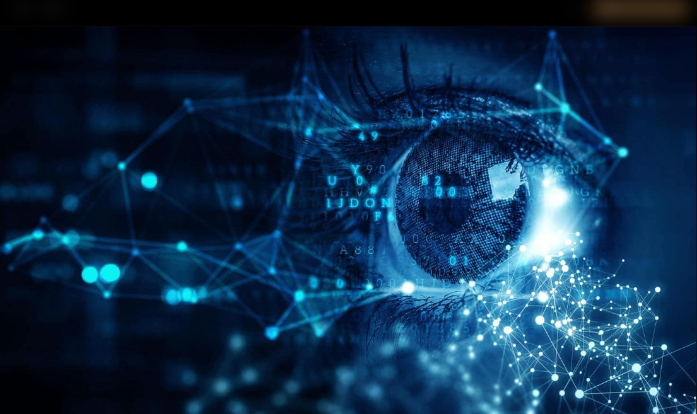

<div align="center">
  
  
  <h1>OBSERVADOR</h1>
  
  
  <em>Plataforma Inteligente de Monitoramento Contínuo e Análise Visual</em></p>
  
  <p><em>"Da percepção visual local à construção de uma inteligência capaz de observar, interpretar e compreender o mundo."</em></p>

  <p>
    
    
    
    
    
    
  </p>
</div>

---


## 1. Sobre o projeto

**Observador** é um projeto de pesquisa e desenvolvimento voltado à construção de um sistema inteligente de percepção ambiental, inicialmente baseado em visão computacional e análise de imagens e vídeos provenientes de câmeras.

A proposta consiste em desenvolver uma arquitetura capaz de observar ambientes, identificar elementos presentes, acompanhar movimentos, reconhecer eventos e transformar informações visuais em dados estruturados.

Em sua concepção inicial, o projeto concentra-se na percepção visual por câmeras, com possibilidades de expansão para integração de múltiplos dispositivos, sensores, fontes geoespaciais e outras modalidades de informação.

A visão de longo prazo é investigar a construção de um observador inteligente capaz de desenvolver uma representação contextual do ambiente, relacionando informações espaciais, temporais e visuais.

O projeto também considera, como direção futura, o conceito de **God's Eye (Olho de Deus)**: uma arquitetura abrangente de observação e inteligência ambiental.

> **Estado atual:** Projeto em fase inicial de concepção e estruturação. Os componentes e funcionalidades apresentados neste documento representam objetivos arquiteturais e possibilidades de investigação, não necessariamente implementações existentes.

## 2. Motivação

### Por que este projeto existe?

Sistemas convencionais de monitoramento visual geralmente são utilizados para capturar imagens, gravar vídeos ou identificar determinados objetos.

Entretanto, observar um ambiente envolve muito mais do que detectar objetos isoladamente.

É necessário investigar como um sistema pode interpretar o que está acontecendo, acompanhar acontecimentos ao longo do tempo, relacionar informações provenientes de diferentes fontes e construir uma compreensão contextual do ambiente observado.

O Observador nasce dessa proposta: explorar a transição entre a simples captura de imagens e uma arquitetura de percepção inteligente.

### Qual é a ideia?

Desenvolver progressivamente um sistema que seja capaz de:

- Capturar e processar informações visuais.
- Identificar objetos e elementos presentes no ambiente.
- Acompanhar objetos e movimentos ao longo do tempo.
- Reconhecer e interpretar acontecimentos.
- Relacionar informações provenientes de diferentes câmeras.
- Integrar dados visuais, espaciais e sensoriais.
- Construir memória contextual dos acontecimentos.
- Desenvolver uma representação dinâmica do ambiente observado.

### O que se pretende investigar?

- Como construir uma arquitetura modular de percepção visual?
- Como acompanhar objetos e acontecimentos em diferentes câmeras?
- Como relacionar informações visuais, espaciais e temporais?
- Como integrar diferentes sensores e fontes de informação?
- Como desenvolver memória e compreensão contextual do ambiente?
- Como evoluir de um sistema de monitoramento para uma arquitetura de observação inteligente?

## 3. Visão e objetivos

A visão de longo prazo é desenvolver uma arquitetura de observação inteligente capaz de perceber, interpretar e relacionar informações do ambiente, evoluindo de uma aplicação de visão computacional para um sistema integrado de percepção ambiental.

Os objetivos iniciais incluem:

- Desenvolver um núcleo de visão computacional.
- Implementar detecção e classificação de objetos.
- Investigar técnicas de rastreamento de objetos.
- Processar imagens e fluxos de vídeo provenientes de câmeras.
- Investigar associação de informações entre diferentes pontos de observação.
- Desenvolver mecanismos de identificação e registro de eventos.
- Investigar integração com sensores e dados geoespaciais.
- Estudar mecanismos de memória e interpretação contextual.
- Explorar a construção de uma representação dinâmica do ambiente.

Esses objetivos representam a direção da pesquisa e não necessariamente funcionalidades já implementadas.

## 4. Fundamentos e conceitos

O projeto considera diferentes áreas de conhecimento:

| Conceito | Aplicação pretendida |
|---|---|
| Visão Computacional | Interpretação de imagens e vídeos. |
| Deep Learning | Aprendizado de características visuais. |
| Detecção de Objetos | Identificação de elementos no ambiente. |
| Object Tracking | Acompanhamento de objetos ao longo do tempo. |
| Multi-Object Tracking | Rastreamento simultâneo de múltiplos objetos. |
| Multi-Camera Systems | Associação de observações entre câmeras. |
| Sensor Fusion | Integração de diferentes fontes sensoriais. |
| Inteligência Espacial | Compreensão de posições e relações espaciais. |
| Event Detection | Identificação de acontecimentos relevantes. |
| Temporal Analysis | Análise da evolução dos acontecimentos. |
| Artificial Intelligence | Interpretação e análise contextual. |
| World Modeling | Representação estruturada do ambiente observado. |

Referências científicas e técnicas serão incorporadas conforme a evolução da pesquisa.

## 5. Arquitetura conceitual

A arquitetura será desenvolvida de maneira modular, permitindo a evolução independente dos componentes e sua integração progressiva.

### 5.1 Vision Core

Núcleo responsável pela percepção visual.

Possíveis funcionalidades:

- Captura e processamento de imagens.
- Processamento de vídeos e streams.
- Detecção e classificação de objetos.
- Segmentação e análise visual.
- Extração de características.
- Reconhecimento de padrões.

### 5.2 Observer Engine

Componente responsável pela observação contínua e acompanhamento dos elementos identificados.

Possíveis funcionalidades:

- Rastreamento de objetos.
- Identificação de trajetórias.
- Associação temporal de observações.
- Análise de movimentação.
- Identificação de eventos.
- Monitoramento de regiões de interesse.

### 5.3 Camera Network

Camada responsável pela integração das fontes de observação visual.

Possíveis funcionalidades:

- Gerenciamento de múltiplas câmeras.
- Identificação de pontos de observação.
- Sincronização temporal.
- Associação de informações entre câmeras.
- Organização dos fluxos de vídeo.
- Expansão para redes distribuídas de observação.

### 5.4 Spatial Intelligence

Componente destinado à interpretação espacial do ambiente.

Possíveis funcionalidades:

- Localização de objetos.
- Construção de relações espaciais.
- Análise de trajetórias.
- Integração com mapas.
- Referenciamento geográfico.
- Representação de ambientes observados.

### 5.5 Event Intelligence

Camada destinada à interpretação dos acontecimentos identificados.

Possíveis funcionalidades:

- Identificação de eventos relevantes.
- Correlação de observações.
- Análise de comportamentos e padrões.
- Identificação de anomalias.
- Organização cronológica dos acontecimentos.
- Produção de informações contextualizadas.

### 5.6 Memory System

Componente destinado ao armazenamento e recuperação de informações observadas.

Possíveis funcionalidades:

- Histórico de observações.
- Registro de eventos.
- Memória temporal.
- Recuperação contextual de informações.
- Associação entre eventos e entidades.
- Construção de histórico de ambientes.

### 5.7 World Model

Camada conceitual destinada à construção de uma representação dinâmica do ambiente.

Possíveis funcionalidades:

- Representação de entidades e objetos.
- Relações espaciais e temporais.
- Associação de acontecimentos.
- Atualização do estado do ambiente.
- Integração de informações provenientes de diferentes fontes.

### 5.8 God's Eye — Visão de longo prazo

God's Eye representa a direção conceitual de expansão do Observador para uma arquitetura abrangente de percepção ambiental.

A proposta é investigar a integração de diferentes fontes de informação:

- Câmeras terrestres.
- Sistemas de monitoramento.
- Sensores ambientais.
- Satélites.
- Dados geoespaciais.
- Sistemas de localização.
- Outras fontes de observação e informação.

O objetivo de longo prazo é investigar como essas fontes podem contribuir para uma representação integrada e contextualizada do mundo.

> God's Eye não representa uma funcionalidade atualmente implementada, mas uma visão futura de expansão do projeto.

## 6. Estado atual do desenvolvimento

Esta seção deverá refletir a situação real dos componentes.

| Componente | Estado | Observações |
|---|---|---|
| Arquitetura conceitual | Em desenvolvimento | Definição dos módulos e responsabilidades. |
| Vision Core | Planejado | Núcleo inicial de percepção visual. |
| Observer Engine | Planejado | Rastreamento e acompanhamento. |
| Camera Network | Planejado | Integração de câmeras. |
| Spatial Intelligence | Planejado | Compreensão espacial. |
| Event Intelligence | Planejado | Identificação e correlação de eventos. |
| Memory System | Planejado | Memória das observações. |
| World Model | Planejado | Representação dinâmica do ambiente. |
| God's Eye | Visão futura | Expansão da capacidade de observação. |

### Classificação dos estados

- **Planejado:** ainda não implementado.
- **Em desenvolvimento:** implementação em andamento.
- **Implementado:** código ou componente existente.
- **Em avaliação:** implementação em processo de testes.
- **Validado:** resultado confirmado em condições experimentais documentadas.
- **Descontinuado:** funcionalidade abandonada ou substituída.

A classificação deverá acompanhar o estado real do código e dos experimentos.

## 7. Roadmap

### Fase 1 — Fundamentos e percepção visual

- Definir a arquitetura inicial.
- Estruturar o repositório.
- Preparar o ambiente de desenvolvimento.
- Investigar modelos de detecção de objetos.
- Implementar os primeiros testes de processamento de imagens.
- Investigar processamento de vídeos.

### Fase 2 — Observação e rastreamento

- Integrar detecção e rastreamento.
- Investigar acompanhamento de múltiplos objetos.
- Desenvolver registro de trajetórias.
- Implementar identificação de eventos básicos.
- Criar mecanismos de armazenamento das observações.

### Fase 3 — Observação integrada

- Investigar integração de múltiplas câmeras.
- Estudar associação de objetos entre pontos de observação.
- Desenvolver sincronização temporal.
- Investigar integração de sensores.
- Desenvolver mecanismos de correlação de eventos.

### Fase 4 — Inteligência espacial e contextual

- Investigar localização e representação espacial.
- Integrar informações geográficas.
- Desenvolver mecanismos de memória.
- Investigar interpretação contextual.
- Construir modelos de representação do ambiente.

### Fase 5 — World Model

- Integrar informações visuais e espaciais.
- Investigar representação dinâmica de entidades.
- Desenvolver mecanismos de atualização de estados.
- Relacionar acontecimentos ao longo do tempo.
- Avaliar consistência das informações observadas.

### Fase 6 — God's Eye

- Investigar integração de fontes distribuídas de observação.
- Estudar integração com dados de satélites.
- Investigar integração de sensores ambientais.
- Desenvolver uma arquitetura de percepção abrangente.
- Explorar a construção de uma representação integrada do mundo.

As fases representam uma direção de pesquisa e não possuem prazos ou resultados garantidos.

## 8. Tecnologias e ferramentas

As tecnologias serão selecionadas conforme os requisitos experimentais e a evolução arquitetural.

| Tecnologia | Finalidade | Situação |
|---|---|---|
| Python | Desenvolvimento e experimentação | Em avaliação |
| OpenCV | Processamento de imagens e vídeos | Em avaliação |
| PyTorch | Desenvolvimento e treinamento de modelos | Em avaliação |
| Ultralytics YOLO | Detecção de objetos | Em avaliação |
| ByteTrack | Rastreamento de objetos | Em avaliação |
| ONNX | Interoperabilidade de modelos | Planejada |
| TensorRT | Otimização de inferência | Planejada |
| PostgreSQL | Armazenamento estruturado | Em avaliação |
| PostGIS | Informações geoespaciais | Planejada |
| Docker | Reprodutibilidade e ambientes | Em avaliação |
| FastAPI | Serviços e comunicação entre módulos | Planejada |

A presença de uma tecnologia nesta lista não significa que ela já esteja integrada ao projeto.

## 9. Experimentos e resultados

Os experimentos serão documentados de maneira independente, permitindo acompanhar a evolução técnica e científica do projeto.

| Experimento | Objetivo | Estado | Resultado |
|---|---|---|---|
| EXP-001 | Detecção de objetos | Planejado | Pendente |
| EXP-002 | Classificação de objetos | Planejado | Pendente |
| EXP-003 | Rastreamento de objetos | Planejado | Pendente |
| EXP-004 | Processamento de múltiplas câmeras | Planejado | Pendente |
| EXP-005 | Identificação de eventos | Planejado | Pendente |
| EXP-006 | Integração de informações espaciais | Planejado | Pendente |
| EXP-007 | Construção de memória contextual | Planejado | Pendente |

Cada experimento deverá registrar:

- Objetivo e hipótese.
- Dataset utilizado e sua origem.
- Configuração experimental.
- Arquitetura e versão dos modelos.
- Ambiente de execução.
- Parâmetros utilizados.
- Métricas e resultados.
- Limitações identificadas.
- Próximos passos.

Nenhum resultado deverá ser considerado validado sem evidências experimentais documentadas.

## 10. Desafios e questões em aberto

Algumas questões técnicas e científicas importantes:

- Como manter a identidade de um objeto observado por diferentes câmeras?
- Como reduzir erros de detecção e rastreamento?
- Como lidar com oclusões e mudanças de iluminação?
- Como sincronizar observações provenientes de diferentes dispositivos?
- Como diferenciar eventos relevantes de acontecimentos comuns?
- Como construir memória contextual sem acumular informações inconsistentes?
- Como representar ambientes dinâmicos?
- Como integrar diferentes fontes de informação sem perder a confiabilidade?
- Como desenvolver uma arquitetura escalável e distribuída?
- Como garantir privacidade, segurança e uso responsável das informações observadas?

Essas questões orientarão as investigações e decisões arquiteturais.

## 11. Referências e trabalhos relacionados

O desenvolvimento do OBSERVADOR considera trabalhos científicos relacionados a visão computacional, rastreamento de múltiplos objetos (MOT), associação de múltiplas câmeras, inteligência espacial e representação de ambientes. As referências abaixo constituem uma base inicial de estudo, não uma declaração de que os mecanismos descritos já foram reproduzidos no projeto.

### 11.1 Rastreamento e Percepção 
1. **VisualByteTrack: Multi-Object Tracking by Associating Every Detection Box (2021)**
* Autores: Yifu Zhang, Peize Sun, Yi Jiang e colaboradores.
* Um método avançado de rastreamento de múltiplos objetos (MOT) que utiliza caixas de detecção de alta e baixa pontuação para manter trajetórias consistentes.
* É uma referência crucial para o * componente "Observer Engine" do projeto, auxiliando no acompanhamento de movimentos ao longo do tempo e mitigando perdas por oclusão.
* Publicação: European Conference on Computer Vision (ECCV).
* DOI: https://doi.org/10.48550/arXiv.2110.06864   

2. **YOLOv7: Trainable bag-of-freebies sets new state-of-the-art for real-time object detectors (2022)**
* Autores: Chien-Yao Wang, Alexey Bochkovskiy e Hong-Yuan Mark Liao.Apresenta arquiteturas de detecção de objetos em tempo real que otimizam a precisão e o custo computacional.
* Referência relevante para a construção do módulo "Vision Core", sendo a base da percepção visual para a identificação inicial dos elementos presentes no ambiente.
* Publicação: IEEE/CVF Conference on Computer Vision and Pattern Recognition (CVPR).
* DOI: https://doi.org/10.48550/arXiv.2207.02696   

### 11.2 Monitoramento Multicâmera e Inteligência Espacial
3. **Features for Multi-Target Multi-Camera Tracking and Re-Identification (2018)**
* Autores: Ergys Ristani e Carlo Tomasi.Trabalho fundamental que explora arquiteturas de Deep Learning para resolver o desafio de rastrear múltiplos alvos através de diferentes
* câmeras simultaneamente (MTMCT) com foco em reidentificação (Re-ID).
* É a base teórica direta para investigar e estruturar a camada "Camera Network".Publicação: IEEE/CVF Conference on Computer Vision and Pattern Recognition (CVPR).
* Link: https://openaccess.thecvf.com/content_cvpr_2018/papers/Ristani_Features_for_Multi-Target_CVPR_2018_paper.pdf   

### 11.3 Compreensão Contextual e World Models
4. **World Models (2018)Autores: David Ha e Jürgen Schmidhuber.**   
* Artigo pioneiro sobre como sistemas baseados em inteligência artificial podem aprender representações espaciais e temporais comprimidas e não supervisionadas de seus ambientes.
* É uma literatura essencial para os módulos "Memory System" e "World Model", embasando a transição de um sistema que apenas detecta objetos para um sistema que constrói uma representação estruturada e contextual do ambiente.Publicação: arXiv.
* DOI: https://doi.org/10.48550/arXiv.1803.10122  

5. **A Path Towards Autonomous Machine Intelligence (2022)**
* Autor: Yann LeCun.Artigo de posicionamento que propõe arquiteturas preditivas (como a Joint Embedding Predictive Architecture) focadas no desenvolvimento de modelos de mundo (World Models) observando acontecimentos.
* Fundamenta a visão de expansão de longo prazo do conceito "God's Eye" e os princípios de uma arquitetura de observação que desenvolve compreensão contextual integrando fluxos espaciais e temporais.
Publicação: OpenReview.
* DOI: https://doi.org/10.48550/arXiv.2206.14176 

Áreas de investigação:

1. Computer Vision.
2. Object Detection.
3. Multi-Object Tracking.
4. Multi-Camera Tracking.
5. Sensor Fusion.
6. Visual Perception.
7. Spatial Intelligence.
8. Event-Based Intelligence.
9. World Models.
10. Distributed Observation Systems.

Projetos, artigos científicos e publicações relevantes serão documentados conforme forem estudados e utilizados.

## 12. Estrutura do repositório

Estrutura inicial proposta:

```text
OBSERVADOR/
│
├── README.md
├── LICENSE
├── .gitignore
│
├── docs/
│   ├── VISION.md
│   ├── ARCHITECTURE.md
│   ├── ROADMAP.md
│   ├── RESEARCH_NOTES.md
│   ├── EXPERIMENTS.md
│   └── DATA_POLICY.md
│
├── src/
│   ├── vision/
│   ├── observer/
│   ├── cameras/
│   ├── tracking/
│   ├── spatial/
│   ├── events/
│   ├── memory/
│   └── world_model/
│
├── experiments/
│   ├── detection/
│   ├── tracking/
│   ├── multi_camera/
│   └── evaluation/
│
├── tests/
│
├── configs/
│
├── datasets/
│
├── models/
│
├── results/
│
├── scripts/
│
└── assets/
```

A estrutura poderá ser modificada conforme os componentes forem implementados.

## 13. Instalação e execução

Esta seção será preenchida quando existir uma versão executável e testada do projeto.

### Requisitos

- Python 3.10 ou superior, sujeito à compatibilidade das dependências.
- Ambiente de desenvolvimento configurado.
- Recursos computacionais compatíveis com os modelos utilizados.
- Câmera ou arquivos de imagem e vídeo para os experimentos.

### Instalação

```bash
# Clonar o repositório
git clone [URL_DO_REPOSITORIO]

# Entrar no diretório
cd Observador

# Criar ambiente virtual
python -m venv .venv

# Ativar no Windows
.venv\Scripts\activate

# Ativar no Linux
source .venv/bin/activate

# Instalar dependências
pip install -r requirements.txt
```

### Execução

Os comandos de execução serão adicionados após a implementação dos primeiros componentes.

> Os comandos de instalação são uma referência inicial. A instalação e a execução deverão ser testadas antes de serem consideradas instruções oficiais.

## 14. Princípios do projeto

O desenvolvimento seguirá os seguintes princípios:

- **Percepção antes da interpretação:** construir uma base confiável de observação.
- **Modularidade:** permitir evolução independente dos componentes.
- **Transparência:** diferenciar objetivos, implementações e resultados.
- **Experimentação:** avaliar hipóteses por meio de testes controlados.
- **Reprodutibilidade:** documentar ambientes, parâmetros e resultados.
- **Escalabilidade:** considerar a expansão para múltiplas fontes de informação.
- **Contextualização:** relacionar observações ao espaço e ao tempo.
- **Privacidade:** respeitar direitos, autorizações e limites legais no tratamento de imagens e informações.
- **Confiabilidade:** registrar incertezas, limitações e possíveis erros.
- **Evolução contínua:** permitir revisões técnicas e arquiteturais.

## 15. Contribuições

O projeto encontra-se em fase de desenvolvimento.

Sugestões, discussões técnicas, propostas de arquitetura e contribuições relacionadas à visão computacional, inteligência artificial, percepção ambiental e integração de sensores são bem-vindas.

As orientações para contribuição poderão ser documentadas futuramente em `CONTRIBUTING.md`.

## 16. Licença

A licença será definida no arquivo `LICENSE`.

Consulte esse arquivo para conhecer as condições de utilização, modificação e distribuição do projeto.

---

<div align="center">

# OBSERVADOR

**Da visão à compreensão do mundo.**

*Perception • Observation • Intelligence • World Modeling*

</div>
